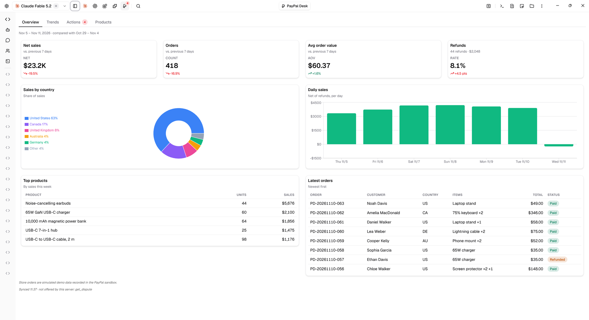
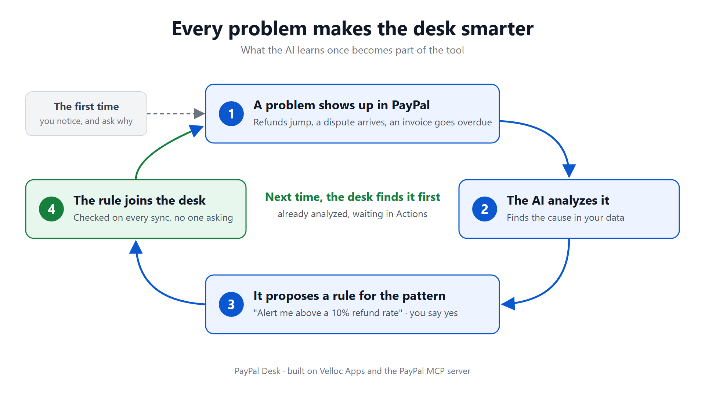
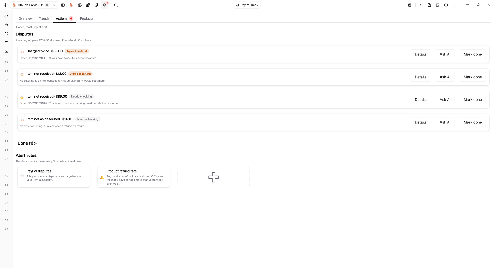
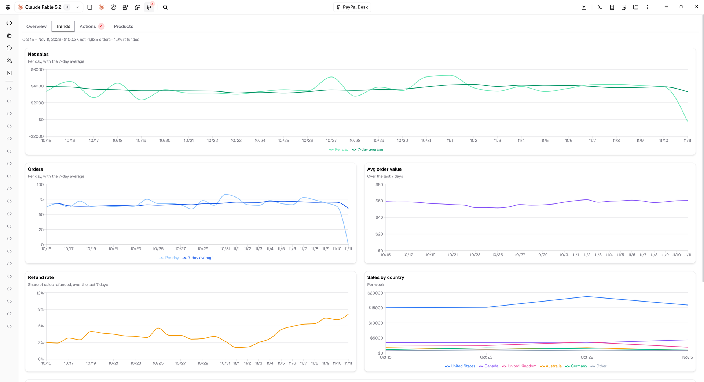
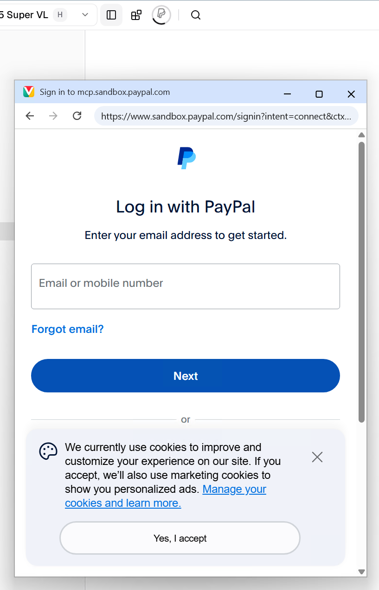

# PayPal Desk

**An AI back office for PayPal merchants that learns, and whose UI the AI
writes.** Every problem the agent solves becomes a rule the desk checks by
itself next time, and every view you ask for becomes part of the app.

Built on the **mod app framework of [Velloc Code](https://velloc.app)**, an
AI coding agent. **This repository is the project's entry point.**

▶ **Demo video:** https://youtu.be/EoIc2DwLSrM



> **A PayPal AI Hackathon 2026 project.** It talks to the PayPal
> **sandbox** only, and is a practice and demo project, not a product for a
> live account.

## Two ideas

### 1. The AI writes the UI (A2UI)

The dashboard is not hand-coded React. It is an
[A2UI](https://a2ui.org) document, `app/app.a2ui`: a declarative,
agent-to-user interface the model can read, write and rebuild. Every card,
chart and table binds to live data (an excerpt):

```
week_daily = Card(Column([Heading("Daily sales", 3, "Net of refunds, per day"),
  BarChart(data=$/data/week/daily, xKey="label", series=[{key: "value", label: "Net sales"}])]))
```

So the person reshapes the app by asking. "Show refunds by week as a bar
chart" or "give this product its own tab": the agent edits `app.a2ui`, calls
`BuildApp`, and the new view is live in seconds, bound to the same data the
module keeps fresh. The app grows with its user, without a release.

### 2. The desk learns



Most AI tools answer and forget. Here, the AI's answer becomes a rule
("alert me when a product's refund rate goes above 10%") that the desk
checks on every sync. Next time it finds the problem first, already
analyzed and waiting in *Actions*. Rules are data, never code: a condition,
or a formula the desk evaluates itself.

## Architecture

```
┌─ Velloc Code ───────────────────────────────────────────────────────────┐
│  velloc-runtime · the mod app framework                                 │
│  ┌──────────────────┐  ┌───────────────────┐  ┌──────────────────────┐  │
│  │ background host  │  │ A2UI surface host │  │ agent                │  │
│  │ one worker / app │  │ build app.a2ui    │  │ the app's session    │  │
│  │ $.app $.mcp $.fs │  │ bind /data        │  │ headless runs        │  │
│  │ publish patches  │  │ route events      │  │ BuildApp, skills     │  │
│  └────────▲─────────┘  └─────────▲─────────┘  └──────────▲───────────┘  │
├───────────┼──────────────────────┼───────────────────────┼──────────────┤
│  Paypal-Desk-Mod · this repository                                      │
│  app-bg.js · lib/           app/app.a2ui           AGENTS.md · skills   │
│  the controller             the view (A2UI)        hooks/guard.js       │
└───────────┬─────────────────────────────────────────────────────────────┘
            │ OAuth · MCP
            ▼
   PayPal MCP server (sandbox): invoices · disputes · transactions · refunds
```

| Layer | Role |
| --- | --- |
| **Background module** (`app-bg.js`) | The controller. Resident while Velloc Code runs; reads PayPal every 5 minutes, computes the figures and the to-dos, and publishes state. No model needed to stay live. |
| **A2UI view** (`app/app.a2ui`) | The view. The runtime diffs each state change into patches; only the bound components re-render. The agent can rewrite it. |
| **Agent** (`AGENTS.md`, `paypal-rules`) | The second author of the view and the analyst. Reviews each dispute and each met alert in background runs; works cases with you in chat. |
| **Guard** (`hooks/guard.js`) | Every PayPal write (refund, invoice, claim) asks you first, whatever the permission mode. |

The framework ([velloc-runtime](https://github.com/VellocLabs/velloc-runtime),
mainly `src/mods/app/`) turns a manifest into all of this: a topbar icon with
a badge, its own folder and session, a resident worker, an A2UI surface and
sandboxed agent runs. Velloc Code's beta ships it with PayPal Desk installed.

**Trust:** PayPal's own OAuth, no stored secret · the module only reads ·
tools scoped to this plugin · background runs read only the app's folder ·
sandbox only.

## The desk



Each dispute carries the AI's verdict and the deciding fact; *Details* holds
the reasons, the next steps and a reply draft. Below, the alert rules and the
card that adds one.



## Get started



1. **Install the beta** of Velloc Code:
   https://velloc.app/download/VellocSetup-beta.exe. On stable? **Settings →
   About → Update Channel → Beta**, then restart.
2. **Add a model** first: **Settings → Models**. Reviews, analysis and
   *Ask AI* need one.
3. **Find the PayPal icon** in the top bar. Not there? **Settings → Plugins &
   Mods → PayPal Desk → Enabled**.
4. **Sign in** with a **sandbox business account**
   ([developer.paypal.com](https://developer.paypal.com/dashboard/) →
   Testing Tools → Sandbox Accounts). The desk opens by itself once the
   account is read.
5. **Try it:** open a dispute's *Details*; ask "why did refunds jump?" and
   accept the rule it offers; ask for a new chart and watch the app change.

<br clear="right">

## Develop

A fresh sandbox has nothing to show. Copy `.env.example` to `.env` with a
sandbox REST app's client id and secret, then:

| Command | |
| --- | --- |
| `npm run seed` · `seed:orders` · `seed:payments` · `seed:disputes` | Invoices, 2,500 store orders, daily payments, one dispute per review case |
| `npm run reset` | Clear what the desk learned, for a demo from nothing |
| `npm test` | The tests (Node 22+) |

```
.claude-plugin/plugin.json   the manifest: app, background module, folder, agent runs
app-bg.js · lib/             the controller: sales, alerts, formulas, dispute review
app/app.a2ui                 the view, in A2UI
app/AGENTS.md                the agent's brief
hooks/ · skills/ · templates/  the write gate, merchant rules, the app's session
```

## License

MIT.
